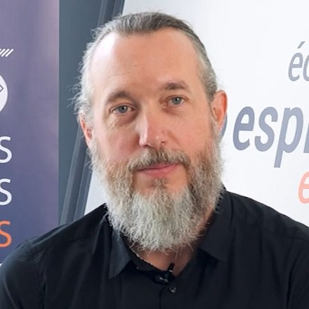

```{r}
source("R/bib.R")
```

::: {.home-wrap}

::: {.home-header}


::: {.home-id}
[Iragaël Joly]{.home-name}
[Associate Professor (HDR) in Economics · Grenoble INP – UGA · GAEL]{.home-role}

::: {.home-links}
[<i class="bi bi-envelope"></i> Email](mailto:iragael.joly@grenoble-inp.fr){.btn .btn-outline-primary .btn-sm}
[<i class="bi bi-linkedin"></i> LinkedIn](https://www.linkedin.com/in/joly-iragael-b5274440){.btn .btn-outline-primary .btn-sm}
[<i class="bi bi-mortarboard"></i> Google Scholar](https://scholar.google.com/citations?user=DdzqOB0AAAAJ){.btn .btn-outline-primary .btn-sm}
[<i class="bi bi-github"></i> GitHub](https://github.com/Iragael38){.btn .btn-outline-primary .btn-sm}
:::
:::
:::

:::: {.home-grid}

::: {.home-main}

I am an Associate Professor (*Maître de conférences*, HDR) in economics at [Grenoble INP – UGA, Génie Industriel](https://genie-industriel.grenoble-inp.fr/) and a member of the [Grenoble Applied Economics Lab (GAEL)](https://gael.univ-grenoble-alpes.fr/).

My work sits at the interface between **econometrics, statistics and data science**. I develop hybrid approaches that combine interpretable econometric models — discrete choice, duration and structural equation models — with machine learning methods, to analyse complex economic data and support decision-making in firms and public policy.

I apply these methods to two main fields: **consumer behaviour** with an environmental dimension (mobility choices, adoption of sustainable products), and the **performance and transformation of firms**, especially circular supply chains and the adoption of artificial intelligence by small and medium-sized enterprises.

## Research interests

- Econometrics and machine learning: complementarities, model comparison, decision-oriented evaluation
- Discrete choice, duration and structural equation models; latent variables and heterogeneity
- AI in firms: deployment conditions, costs, skills and sustainability
- Circular economy and sustainable supply chains
- Transport economics and travel behaviour

## Education

- **HDR** (Habilitation to supervise research) in Economics, Université de Lyon, 2017
- **PhD** in Economics, Université de Lyon, 2005

:::

::: {.home-side}

## Ongoing projects

- **AI demonstrator — MIAI Grenoble Alpes** (2026–2029). Opening the hood of an AI system to understand its stakes, from sustainable AI to industrial integration and the transformation of jobs.
- **ACCEL 4.0 / ACCEL4.S industrial chairs** (2021–). Lead of the AI axes: AI for the circular economy and for sustainable performance, through support to manufacturing SMEs.
- **ITICIA** (2024–). Training board of the regional AI consortium in Auvergne-Rhône-Alpes: a professional training offer in AI, its labelling, and a shared space for the actors of AI in Grenoble.

```{r}
#| results: asis
phd <- read.csv("data/phd-supervision.csv", encoding = "UTF-8", stringsAsFactors = FALSE)
phd <- phd[phd$outcome == "Ongoing", ]
for (i in seq_len(nrow(phd))) {
  cat("- **PhD thesis of ", phd$student[i], "** (", phd$period[i], "). [*", phd$title[i],
      "*](phd/", phd$slug[i], ".qmd)\n", sep = "")
}
cat("\n[Research and projects →](research.qmd)\n")
```

:::

::::

## Recent publications

```{r}
#| results: asis
recent <- recent_items(c(
  "data/bib/articles-comite-lecture.bib",
  "data/bib/actes-colloques-comite.bib"
), n = 6)
cat("::: {.pubs}\n")
for (e in recent) cat("- ", format_entry(e), "\n", sep = "")
cat(":::\n\n[All publications and talks →](publications.qmd)\n")
```

:::
