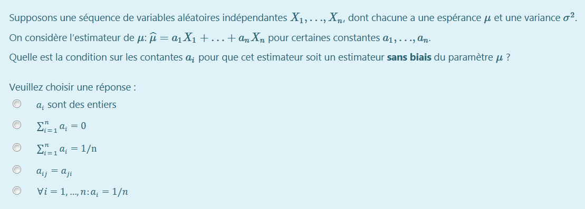
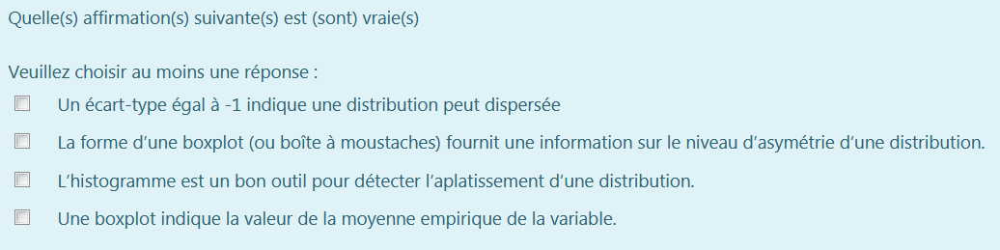
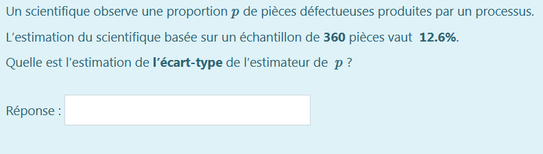
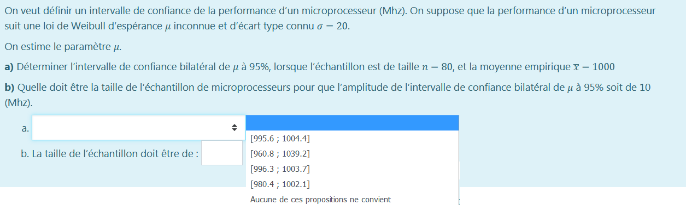

This post shows how to write quiz questions in RStudio with the [R/exams](https://www.r-exams.org/) package, export them to Moodle's XML format, and import them into a Moodle platform such as [Caseine](https://moodle.caseine.org/). It is an English version of a guide I first wrote in 2019, lightly updated.

## Why combine R and Moodle?

R and Moodle share a common file standard for quizzes: **XML**. The `exams` package writes questions — with their answers and solutions — in this Moodle-compatible format.

This means you can write your questions in RStudio, **locally**: store them, organise them and edit them on your own computer, then export them to Moodle as easily as you would render a document to PDF, Word or HTML. RStudio becomes a single platform to produce all your dynamic documents, quizzes included.

### What Moodle does well

With a little experience of Moodle, you quickly discover how to structure quizzes, exercises and questions:

- several successive questions can form one **exercise** — no need to force a single question to do everything;
- but such questions are then fixed and identical for everyone (no random draw of the question), and they appear in separate blocks.

::: {.callout-tip}
Explore Caseine and try importing a few files **before** writing your first questions in R.
:::

## Setting up a test on Caseine

### Importing the XML file

You import a file with the `.xml` extension. It can contain:

- **a single question**: only this question is imported;
- **a series of questions**: they appear in Moodle's question bank as a series, in the order of the XML file. The series can form one exercise of several questions;
- **a complete test**: all the questions are imported in one go, in the order of the file. You can then reorder them, randomise all or part of the order, and so on.

Caseine creates a group of questions with a label, under which the imported questions are stored. You can then use the whole group or individual questions.

::: {.callout-warning}
- Caseine creates a new label for **every import**. Questions or labels with the same name are not overwritten: each imported version is kept, and questions are duplicated rather than replaced.
- Some LaTeX commands block the import, for example `\mathcal{}`.
:::

### Step by step on Caseine

1. Questions go to the **question bank**, a space shared by all your courses.
2. In the question bank, open the **Import** tab.
3. Select the **Moodle XML** format and choose your `.xml` file.
4. This creates a "group" in the bank — a kind of drawer, which is not the same as a Moodle *category*.
5. From the test, add the questions with **Add from question bank**.

### Configuring the test

Moodle lets you create **sections** in a test. All the questions of a section are handled the same way (random draw, display conditions, etc.). Sections allow you to:

- chain questions into an exercise;
- draw questions at random from a group or category;
- set page breaks and section titles.

A useful practice is to start the test with a section of **ungraded questions recalling the instructions**: rounding rules, tolerance, decimal separator (`,` vs `.`), percentages, negative marking, closing time of the test, and whether part of the answers must be handed in on paper.

Everything else — visibility, the type of feedback given to students (score, answers, comments) — is set in Moodle.

## The R/exams package

For a first use:

```r
install.packages("exams")
```

Then load the package at each session:

```r
library("exams")
```

Documentation and many examples are on [r-exams.org](https://www.r-exams.org/).

## Organising the project

A test project is made of:

1. **a generator script** (for example `R2M.R`) that assembles the questions and writes the XML file;
2. **one file per question** (`Q1.Rmd`, `Q2.Rmd`, …).

Tips:

- always use the same encoding, preferably **UTF-8**;
- organise your folders: for example one folder with all the questions of a test, loaded in one go, or one folder per topic, from which you pick questions for each test.

### The generator script

It takes the question files as input and writes an `.xml` file. A few options are set at the level of the whole quiz (others are set in the question files):

- `dir`: output directory;
- `name`: name of the file and of the test;
- `encoding = "UTF-8"`;
- `converter = "pandoc-mathjax"`: how equations are rendered (works well in all browsers).

The script can sit in the folder that contains the questions — the simplest option to load them all at once — or elsewhere, pointing to the questions' location.

### The question files

Each question is an `.Rmd` file (simpler) or an `.Rnw` file (closer to LaTeX, with more parameters), including the question, the solution and the metadata. The structure is the same for every type of question, and you can use R at several levels:

1. write your own questions;
2. program your own questions (with computed values);
3. program the personalisation of questions (different data for each student).

## The generator script, in practice

### Version 1: list the questions explicitly

```r
options(device.ask.default = FALSE)
mydir <- "ExamStat2019/questions"   # folder with the questions and the output

## Moodle XML
exams2moodle(file = list("EX01.Rmd"), dir = mydir,
             name = "test_demo", encoding = "UTF-8")

## HTML preview, handy to check the questions
exams2html(file = list("EX01.Rmd", "EX02.Rmd"), dir = mydir,
           name = "test_demo", encoding = "UTF-8")
```

- `file`: the list of question files;
- `dir`: the folder for the output;
- `name`: the name of the `.xml` file;
- `encoding`: UTF-8 is recommended.

### Version 2: take every question in a folder

```r
options(device.ask.default = FALSE)
mydir <- "ExamStat2019/questions"

## all the .Rmd question files in the folder
myexo <- list.files(path = mydir, pattern = "\\.Rmd$")

exams2moodle(file = myexo, n = 1, dir = mydir,
             name = "Test_QCM", encoding = "UTF-8")
```

`n` sets the number of versions of the test to produce.

## Writing a question file

Every question file follows the same structure:

```markdown
Question
========
Answerlist
----------
* item

Solution
========
Answerlist
----------
* item

Meta-information
================
exname: Title
extype: schoice
exsolution: 00100
exshuffle: TRUE
```

### The question

Two tags define the question (`Question`) and, when there are any, the answer options (`Answerlist`):

```markdown
Question
========
Write your question here...

Answerlist
----------
* a first answer option
* a second answer option
* ...
```

The options can be shuffled when displayed to students, but you must keep their order when writing the solutions. For a numerical question, the answer list is not needed.

### The solution

The solution or explanation goes after the `Solution` tag. With an answer list, keep the same order as in the question:

```markdown
Solution
========
Write the solution here.

Answerlist
----------
* Comment or solution for the first option
* Comment for the second option...
* ...
```

The correct answers themselves are given in the metadata. Depending on the feedback options chosen in Caseine, students see the options, then the correct answers, then the comments — so there is no need to repeat the wording of each option in the solution.

### The metadata

The type and parameters of the question are set under `Meta-information`:

- `exname`: title of the question (used only to identify it);
- `extype`: type of question —
  - `schoice`: single choice (e.g. true/false),
  - `mchoice`: multiple choice (several boxes to tick, wrong ones with negative points),
  - `num`: numerical answer, a value is expected ± a tolerance,
  - `cloze`: mixed format, combining numerical answers and choices;
- `exsolution`: the correct answers — a string of 0s and 1s for `schoice` and `mchoice`, a value for `num`, a combination separated by `|` for `cloze`;
- `exshuffle: TRUE`: shuffles the answer options.

## Question types, as students see them

### Single choice: `schoice`

{fig-alt="A single-choice question displayed in Moodle"}

### Multiple choice: `mchoice`

{fig-alt="A multiple-choice question displayed in Moodle"}

### Numerical: `num`

{fig-alt="A numerical question displayed in Moodle"}

The question asks for a value, the solution explains how to compute it, and the metadata set the expected value and the tolerance `extol`. `fmt(value, 3)` formats the value with three decimals:

```markdown
Meta-information
================
extype: num
exsolution: `r fmt(value, 3)`
exname: constant c
extol: 0.02
```

### Mixed: `cloze`

{fig-alt="A cloze question mixing a drop-down choice and a numerical answer in Moodle"}

## Open questions

When I wrote this guide, a few things remained unsolved:

- **Moodle**: printing all the questions with their solutions and comments to PDF; deleting an answer option from a multiple-choice question (the box remains).
- **R/exams**: setting the points of a question; configuring question pages and their titles; showing the identifiers or titles of exercises to find them easily.

## Practical remarks

- Check the Caseine student list against the official class list: email, surname, first name.
- Recall the instructions at the start of the test: validate the end of the test, rounding rules, tolerance, negative points, percentages.
- Check how equations render in different browsers (see the `converter` option in R).
- The CSV export of results may have encoding issues: check accents when opening it.

### Submitting on behalf of a student

If a student could not submit (technical problem, for example), here is a procedure — there may be simpler ones:

1. As a teacher, change the test settings: reopen the test (*Timing › Close the quiz*), allow one more attempt (*Grade › Attempts allowed*), and set each attempt to build on the last (*Question behaviour › Each attempt builds on the last*).
2. Log in as the student: click on their name in the list of participants or attempts, then *Log in as*.
3. Start a new attempt. You can change answers if needed, or go straight to the end and submit.
4. Return to your own identity and **reset the settings of step 1**, especially the closing date.
